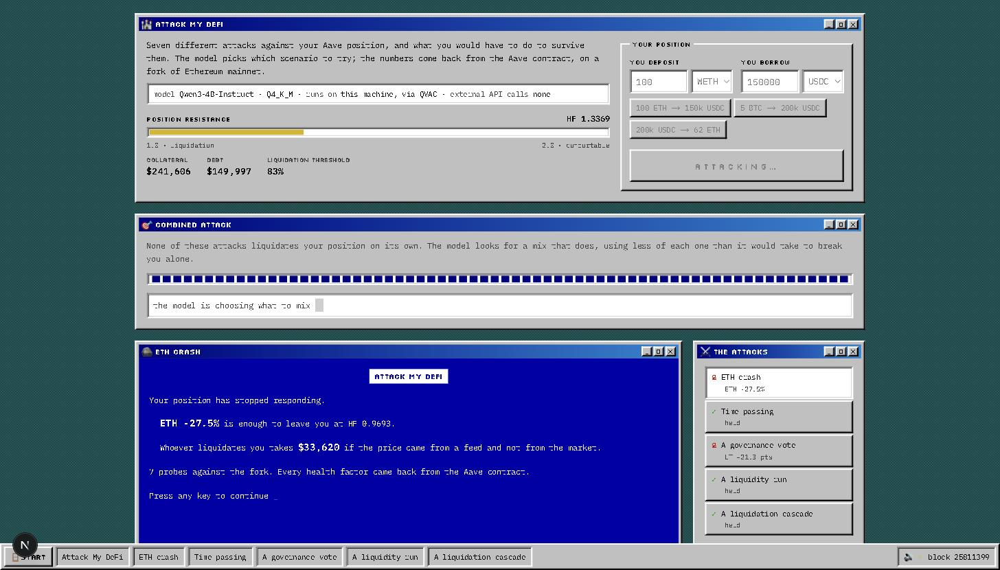
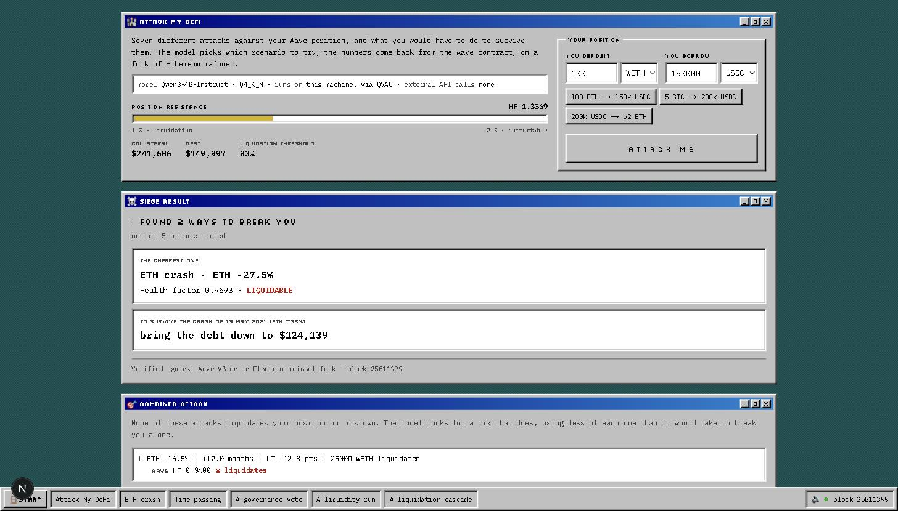

# Attack My DeFi

You pick a lending position on Aave V3 and a battery of attacks looks for the mildest scenario
that liquidates it — six of them one at a time, plus one that combines them. Every health factor you see comes back from the Aave contract, on
a fork of Ethereum mainnet, and the model that chooses the scenarios runs entirely on your
machine.

```
I FOUND 2 WAYS TO BREAK YOU
out of 5 attacks tried

  The cheapest one
  ETH crash · ETH -27.5%
  Health factor 0.9693 · LIQUIDATABLE

  To survive the crash of 19 May 2021 (ETH -35%)
  bring the debt down to $124,139

Verified against Aave V3 on an Ethereum mainnet fork · block 25811399
```



*The combined attack searching, with the ETH crash already broken through on the left and the
queue of attacks on the right.*

## The problem this solves

A language model can write "your health factor would be 0.95" with complete confidence and be
completely wrong. In finance that is not a cute mistake: it is a false conclusion presented as
a calculation.

Here the model never produces a number. It chooses which scenario to try; the simulator
applies that scenario to a real fork and asks Aave what happened. The only source of health
factors is the contract.

| What | Who | Why |
|---|---|---|
| The numbers | The Aave contract | A model can hallucinate; a contract cannot |
| The search mechanics | The code | Deterministic and boring |
| Which scenario to try | The local model | Takes judgement, and it is the interesting part |



## How it works

The simulator spins up a fork of Ethereum mainnet with Anvil, pinned to a fixed block, and
builds the position for real: it acquires the collateral, deposits it into Aave and takes out
the loan. These are transactions Aave processes.

To simulate a scenario it replaces the price source Aave consults with a controllable mock
—using the protocol's own admin function, `setAssetSources`, impersonating the ACLAdmin— and
then asks the Pool how the position stands. **Aave recomputes the health factor with its own
logic**, from our input price.

Every scenario runs from a snapshot and reverts when it finishes, so none contaminates the
next.

Attacks run one at a time, not in parallel: the fork is an exclusive resource and an audit is
not a read —it builds a position, breaks it and reverts—. A lock with an owner keeps two runs
from colliding, because when that happens the symptom is an incomprehensible revert somewhere
entirely unrelated.

### The six individual attacks

Which ones apply depends on the position, and never all six at once: there is no point looking
for a depeg against someone who holds no stablecoin, and a WETH liquidation cascade only drags
down a position collateralised in WETH. Those two are mutually exclusive, so a given position
faces at most five individual attacks, plus the combined one.

- **Collateral crash** — the price Aave uses for your collateral drops, whether the market fell
  or the feed failed. When the collateral is a stablecoin the attack flips around and targets
  the debt getting more expensive, which is where the damage would come from.
- **Stablecoin depeg** — only when the stablecoin is the collateral. Downward it destroys
  whoever deposited it; upward it hurts whoever owes in it, which is the opposite of what the
  word suggests.
- **Time passing** — nothing happens in the market and the debt grows anyway, from the variable
  interest Aave accrues. It is the only attack that does not need the world to move.
- **A governance vote** — Aave lowers the liquidation threshold on your collateral. It has
  happened several times for real, and it is the attack that depends not on the price but on
  the rule you are measured by.
- **A liquidity run** — a whale drains the pool and the variable rate spikes. It runs against
  its own snapshot, so what the whale does to the world does not contaminate the other attacks.
- **A liquidation cascade** — someone else gets liquidated, their collateral is dumped on the
  market, and the price drags you down. Capped at 25,000 WETH, around 60 million dollars sold
  at once: more than Aave liquidated in all of March 2020.

### And one more: the combined attack

The six above are found by bisection, and it is worth saying before someone else does: **the
model does not add much there**. Given the interval where the threshold lies, the next value
to try is the midpoint, and that is a three-line loop.

The combined attack is a different problem. It runs last, once we know how much each attack
takes on its own, and it looks for a mix that liquidates the position **using less of each
attack than it would take to break it alone**. No single piece is enough; the only way to win
is for them to add up.

There is no formula for that. The space is every subset of attacks across every intensity, and
choosing which mix is worth trying depends on understanding that time and liquidity both push
on the debt, or that price and the liquidation threshold both bite into the collateral. It is
the one place in this project where the model does something the code could not do just as
well, and that is why it closes the audit.

On a position of 100 WETH against 180,000 USDC —health factor 1.1141— the six individual
attacks each need, on their own, ETH dropping 12.5%, or 4.4 years of interest, or governance
cutting the threshold by 8.8 points, or a 12,500 WETH liquidation. The model found this:

```
ETH -5.0%  +  21 months  +  LT −3.5 pts  +  5,000 WETH liquidated  →  HF 0.9602
```

Each piece sits at 40% of what it would take to liquidate on its own — not even half. None of
them breaks you. All four together do.

## Local inference

All inference runs through [QVAC](https://qvac.tether.io) on a quantized **Qwen3 4B
Instruct** — four billion parameters, on your laptop. No API keys, no data leaving the machine, and after the first download it works
without internet except for the fork's RPC.

Getting a 4B model to use tools reliably was the real work of this project:

**The tools never reached the prompt.** The SDK requires `modelConfig: { tools: true }` when
loading the model. Without that option the model replies "I don't have access to tools",
without raising any error. Five tool-calling dialects and three different models were tried
before finding it.

**It reasoned for 278 seconds before acting.** Qwen3 deliberates by default and burned
thousands of tokens before a single call. With `reasoning_budget: 0` each step dropped to
~1.5s. There is nothing to deliberate here: there is a number to choose.

**Asked an open question, it swept.** Asking "what should we try now?" it moved in steps of 5
and settled on a coarse value, off by 4.8 points. Given the already narrowed range —"the
threshold is between -25% and -30%, try the midpoint"— it bisects and converges. We did not
change models: we asked a question a 4B can actually answer well.

**It repeated its first idea until the budget ran out.** On the combined attack it proposed one
mix and then kept proposing the same one, failing 9 out of 10 times. It was receiving the
history of what had been tried, but nobody had told it that repeating was pointless. Saying so
explicitly, and raising the temperature with each failed attempt, took it from 1/10 to 10/10.

**It is treated as an untrusted source**, like user input: its proposal is validated and
normalised at the boundary (it sends `+25` when it means `-25`), repeated scenarios are
discarded, and there are caps on steps and refusals.

## Evidence

"Reliable" without numbers is an opinion, and so is "the model helps". Two scripts answer
those two questions separately.

### Does it use tools correctly?

`pnpm evidence` runs the same attack several times, each with a different seed, and measures
whether it converges on the same threshold and how often the code had to cover for the model.

```
  seed 100 →   ETH -27.5% in  7 probes ·  37s
  seed 101 →   ETH -27.5% in  7 probes ·  35s
  seed 102 →   ETH -27.5% in  7 probes ·  35s
  seed 103 →   ETH -27.5% in  7 probes ·  41s
  seed 104 →   ETH -27.5% in  7 probes ·  34s

Threshold: found in 5/5 runs · mean -27.50 · spread 0.00 points
Tool use: 35 requests · 35 returned a usable call with no fixing (100%)
  answered in prose without calling the tool: 0
  proposed an out-of-range value, had to be clamped: 0
  proposed a scenario already tried: 0
```

That 0.00 spread deserves a caveat, because read on its own it says something untrue. The
consistency does not come from the model being infallible: it comes from the question barely
admitting variation. When the prompt hands over the already narrowed interval and asks for the
midpoint, the correct answer is practically unique and the seed has nothing to grab onto.

The number that shows the real work is the other one: **asked an open question the same model
was off by 4.8 points**. Bringing that to zero was not achieved by changing models, but by
changing the question.

### Is the model worth anything?

That is the uncomfortable question, and for bisection the honest answer is "not much". So the
combined attack is measured against the dumbest possible baseline: picking attacks and
intensities at random, with the same budget of attempts, the same cap per component and the
same number of attacks to combine. On the reference position of 100 WETH against 150,000
USDC:

```
  model    liquidated in 10/10 runs (100%) · 1.9 attempts on average
  random   liquidated in  8/10 runs  (80%) · 1.9 attempts on average
```

The advantage is reliability, not speed: the model finds the mix in every run, random misses
two out of ten — and when random does hit, it takes just as long. The baseline uses a seeded
generator so `pnpm combined-check` reproduces exactly these numbers.

Getting to a number that means anything took three measurements, and the two failed ones are
worth more than the final one.

**First, the problem was too easy.** Each component could enter at 85% of its individual
threshold — so close to liquidating alone that almost any mix worked, and random tied. Dropping
the cap to 60% did not fix it either: there the winning move is "push everything to the
maximum allowed", which takes no judgement at all. Only at 40%, where not even half of each
threshold is available, does choosing *what* to combine start to matter.

**Then the comparison turned out to be rigged**, and not on purpose. The model could combine
all four available attacks while random could only pick two or three. An adversarial review
caught it. Once both sides saw the same options, an earlier published claim —that random fails
three times out of ten— stopped being true at that cap.

**And then the model lost, badly: 1/10 against random's 9/10.** The reason was in a counter
added while fixing the above: `5 wasted turns` on nine of the ten runs. The model proposed one
combination and then repeated it until the budget ran out. When its first idea was not enough,
it did not explore.

That last one is the interesting failure, because it was not the model's fault so much as the
prompt's: it received the history of what had been tried but was never told that repeating it
was pointless. Saying so explicitly, and raising the temperature with each failed attempt so it
does not stay glued to its first idea, took the same model from 1/10 to 10/10.

The same lesson as with bisection, in a different disguise: what changed was not the model, but
the question.

### How it fails

Knowing that it works matters less than knowing how it breaks. Three failure modes that showed
up while running this:

**A failure was reported as good news.** A `catch { break }` swallowed any simulation error, so
a run that fell over from a network problem ended up reporting "no threshold found" — which
the interface translates into "your position survived". That is the worst possible failure
mode for a risk tool. Now the failure travels with its reason.

**Two audits at once collided.** The fork is an exclusive resource, and without a lock one run
would reset the world while another was halfway through building its position. The symptom was
a `HealthFactorLowerThanLiquidationThreshold` on a borrow that had nothing wrong with it.

**The "clean" world could be dirty.** If the reference snapshot was taken over a state that
already had a position in it, every run started from there piling up debt. It did not fail: it
returned plausible, wrong thresholds, which is the one error this project cannot afford. The
reset now verifies where it landed before accepting it.

## The impact curve

The cascade attack needs to know how far the price drops when you sell N WETH at once. Quoting
that against Uniswap on every probe means hundreds of storage reads the fork requests one at a
time: minutes per simulation, and sometimes a timeout that takes down the whole search.

But the block is frozen, so that curve does not change between runs. `pnpm impact-curve`
measures it once against the real pools and leaves it as a table of 18 points —closer together
at the low end, which is where the curve bends—; the attack interpolates. The numbers come
from the same place as always: all that changed is when they were read.

`pnpm curve-check` is what holds the change up: it compares the table against real quotes at
points that are not in it, which is exactly where an interpolation would drift.

```
  amount     table     quoted     drift
     777    1.00%      1.00%   0.001 pts
    3333    4.16%      4.19%   0.031 pts
    7777    7.96%      7.96%   0.009 pts
   13421   10.73%     10.74%   0.015 pts
   19050   12.87%     12.88%   0.007 pts
   23500   14.36%     14.34%   0.016 pts
```

Above the last measured point it returns the last known value instead of extrapolating.
Stretching a liquidity curve past what was measured is exactly the kind of number this project
does not produce.

## Running it

Requires Node 22, pnpm and [Foundry](https://getfoundry.sh).

```bash
pnpm install
cp .env.example .env.local     # and set your Ethereum mainnet RPC (archive access needed)
```

Start the fork in a separate terminal, pinned to the block in `.env.local`:

```bash
anvil --fork-url $ETHEREUM_RPC_URL --fork-block-number 25811399 --port 8545
```

Get it ready to work, once:

```bash
pnpm warm
```

That pulls the world from the RPC and caches the Uniswap pools. Without it the first run pays
that whole download, which against a free plan takes minutes. **Stop Anvil with Ctrl+C, not
`kill -9`**: the cache is written to disk only on a clean exit, and losing it means warming up
again.

And the app:

```bash
pnpm dev
```

The first run downloads the model (~2.5 GB). After that it stays cached.

### Verification

```bash
pnpm tsx --env-file=.env.local scripts/m1-check.ts        # the engine against the analytic formula
pnpm tsx --env-file=.env.local scripts/m2-check.ts        # the attacker converges
pnpm tsx --env-file=.env.local scripts/vectors-check.ts   # each attack returns something coherent
pnpm tsx --env-file=.env.local scripts/wbtc-check.ts      # a position with BTC as collateral
pnpm tsx --env-file=.env.local scripts/audit-check.ts     # the full audit, end to end
pnpm evidence                                             # tool use reliability
pnpm combined-check                                       # the model against picking at random
pnpm curve-check                                          # the table against real quotes
```

`m1-check` is what holds everything else up: it compares the threshold the engine finds —by
asking Aave— against the analytic formula applied to the position's real state. They match
within 0.0002 points. The expected value is derived from the state that was read rather than
hardcoded, because it depends on the price at the pinned block.

`wbtc-check` verifies something a more obvious test lets through: not just that the health
factor matches the formula, but that **the shock hits the right asset**. A ternary that assumed
there were only two assets made a shock on WBTC hit the price of the debt instead, and with BTC
dropping 30% the health factor went *up*. The formula was right; what was wrong was what it was
being applied to.

## Traps worth knowing about

**`getUserAccountData` mixes three scales.** USD amounts come with 8 decimals, the health factor
with 18, and thresholds in basis points. It is the most likely source of error when integrating
Aave.

**viem does not throw when a transaction reverts.** `waitForTransactionReceipt` returns the
receipt with `status: 'reverted'` and the code carries on as if nothing happened. Here every
write goes through a helper that checks the status: without it, the `borrow` failed silently
and the position ended up with no debt, reporting an infinite health factor — "your strategy is
invulnerable".

**Aave's `borrow` dies with OutOfGas** if you trust automatic gas estimation, and
`simulateContract` does not catch it.

**viem errors quote the entire request**, and the one for `anvil_reset` carries the RPC URL with
the API key inside. That text reaches the browser as an error message and shows up on screen.
Only the origin of each URL survives.

**An RPC that returns HTML kills Anvil.** Public endpoints occasionally answer with a Cloudflare
error page instead of JSON, and Anvil panics parsing it. If it dies with no explanation, that is
usually why.

## Limitations

One protocol (Aave V3 on Ethereum mainnet) and three assets (WETH, WBTC, USDC). The cascade is
capped at 25,000 WETH because nothing beyond that was measured, and the curve is not
extrapolated. The combined attack leaves out the ones that need to prepare the world before
running, because only one preparation can be active at a time.

We choose the scenarios: the system tells you what happens to a position under those scenarios,
on a state of the chain frozen at one block. Nothing here predicts what the market will do, and
none of it is financial advice.

## Stack

Next.js · TypeScript · viem · Zod · Foundry/Anvil · Aave V3 · QVAC + Qwen3 4B

## License

MIT
